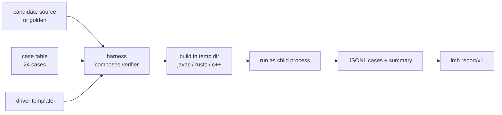

# polyglot-llm-harness (`lmh`)

One tiny verifier protocol for grading candidate solutions to coding tasks —
implemented three times, in **Java**, **Rust** and **C++**, with zero
dependencies and byte-identical reports.

I design coding environments that challenge and grade AI models for a living,
and this is the core of such a harness reduced to its essentials: a task
registry, generated verifiers, subprocess isolation, and a report format every
implementation must reproduce exactly. Writing it three times is the fastest
way I know to feel where each language fights you and where it quietly helps.

## How it works



The harness never loads candidate code into its own process. A candidate is
untrusted input: it is copied into a disposable directory, combined with a
generated driver, compiled by the platform toolchain and executed as a child
process whose stdout is parsed under a strict JSONL contract (see
[docs/spec.md](docs/spec.md)).

## Quickstart

```console
$ make smoke          # builds all three, grades all 9 task×impl pairs
$ make java           # java only: javac -d java/build ...
$ rust/target/release/lmh run lru-cache
task lru-cache · impl rust · source golden
  pass hit_returns_value               0.016ms
  ...
8/8 passed · score 1.000 · 1462.8ms
```

Grade an arbitrary candidate instead of the golden:

```console
$ java -cp java/build dev.edxeme.lmh.Main run lru-cache \
      --candidate examples/buggy-lru/LruCache.java
task lru-cache · impl java · source .../examples/buggy-lru/LruCache.java
  pass hit_returns_value               0.513ms
  pass miss_returns_sentinel           0.013ms
  pass oldest_evicted                  0.113ms
  FAIL update_refreshes_recency        3.360ms  AssertionError: get(2) should have been evicted: expected -1, got 20
  FAIL get_refreshes_recency           0.042ms  AssertionError: get(2) should have been evicted: expected -1, got 20
  pass overwrite_same_key              0.012ms
  pass capacity_one                    0.023ms
  pass rejects_zero_capacity           0.491ms
6/8 passed · score 0.750 · 1003.1ms
```

The case table is deliberately adversarial around the classic LRU bugs: a
cache that forgets to refresh recency on `get` or on overwrite fails here even
though it survives most textbook tests.

## The tasks

| task | what it stresses |
| :--- | :--- |
| `merge-intervals` | sorting invariants, boundary touching, input validation |
| `lru-cache` | O(1) data-structure design, recency semantics |
| `rate-limiter` | sliding windows, expiry boundaries, rejected-request accounting |

Each task has a language-agnostic statement in [tasks/](tasks/), per-language
golden solutions, and a case table compiled into the generated verifier.

## Parity

`lmh.report/v1` is emitted identically by all three implementations. CI diffs
the normalized reports (timings and impl labels stripped) across all nine
task×impl pairs, and asserts that a known-buggy candidate fails everywhere.

## Implementation notes

- **Java** — `ProcessBuilder`, verification via a generated `LMHVerifier`
  compiled with `javac`. The LinkedHashMap golden is the idiomatic 20-liner.
- **Rust** — a zero-dependency crate; goldens are embedded with
  `include_str!`; candidate panics are caught per case with `catch_unwind`
  and captured through a panic hook so one bad case can't kill the run.
- **C++** — CMake builds the harness; generated verifiers compile with
  `c++ -std=c++17`; `popen` keeps the POSIX surface honest (merged diagnostics
  for the compile, split stdout/stderr for the verifier).

Rough numbers from the first cut (see [docs/notes.md](docs/notes.md)):
~830 lines for Java, ~920 for Rust, ~1000 for C++; a cold verifier run costs
~1.0s (javac), ~1.5s (rustc) and ~2.0s (c++) on an M-series MacBook.

## License

MIT — see [LICENSE](LICENSE).
